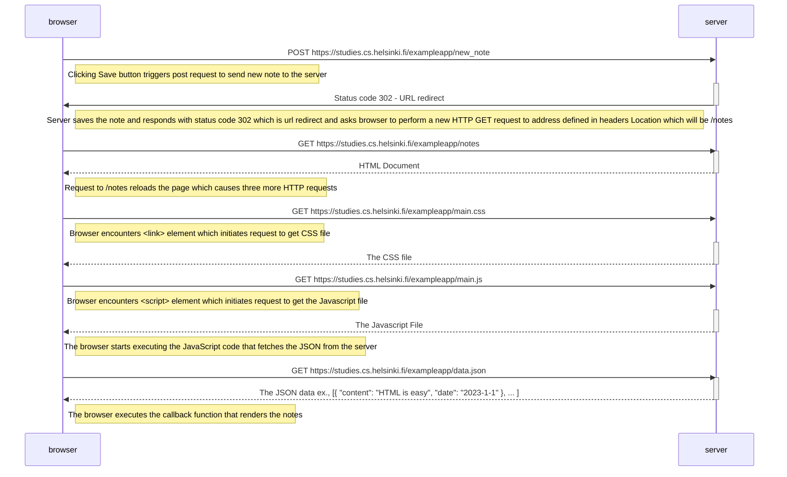
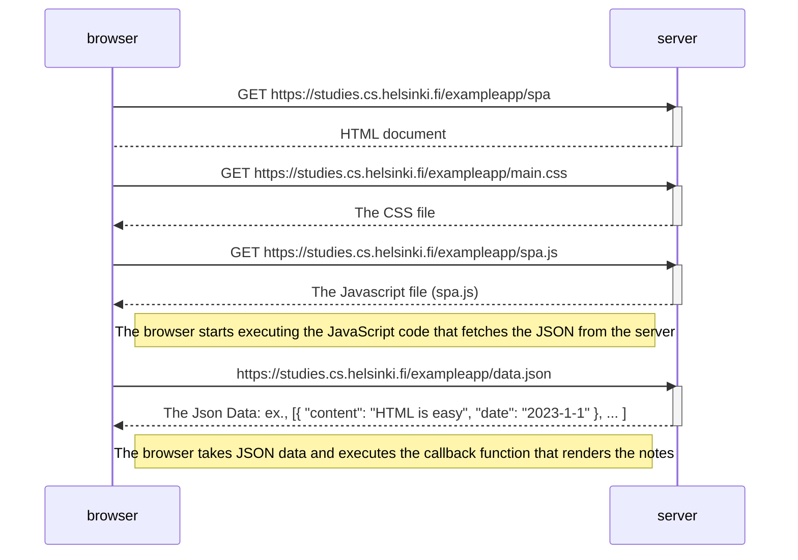
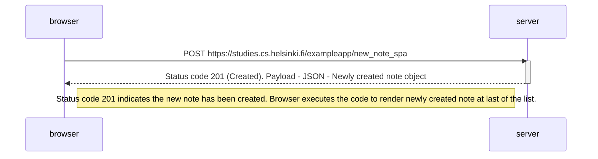

# Part 0: Fundamentals of how web application works Exercise submissions

## Exercise 0.4: New Note diagram - solution

## Exercise 0.5: Single Page App (SPA) diagram - solution

## Exercise 0.6: New note in Single Page App diagram - solution

